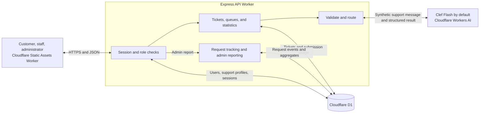

# TicketMaestro

TicketMaestro is a support portal for NorthLink Internet, a fictional Canadian internet provider. A customer submits a ticket and can follow its status. Cloudflare Clef Flash suggests a department and urgency, and the API routes a validated decision to Billing, Technical, Account, or General Support. Support staff can search queues, review uncertain results, and correct routing. Administrators can view API traffic, ticket statistics, and registered users.

## Run locally

Use Node.js 22.14 or newer. From `backend`, install dependencies, migrate the local D1 database, and seed the synthetic demonstration accounts and tickets.

```powershell
npm.cmd ci
npm.cmd run db:local
node scripts/demo-sql.js --tickets | Set-Content -Encoding ascii .wrangler/demo.sql
npx.cmd wrangler d1 execute DB --local --file .wrangler/demo.sql
npm.cmd run dev
```

From the repo root in another terminal, start the static client.

```powershell
./backend/node_modules/.bin/wrangler.cmd dev --config frontend/wrangler.toml --port 8788
```

Open [TicketMaestro](http://localhost:8788). The API listens on `http://localhost:8787`.

| Workspace | Demo account | Local password |
| --- | --- | --- |
| Customer | `john@john.com` | `123` |
| Technical support | `technical@example.test` | `NorthLink-demo-only-Workshop42!` |
| Administrator | `admin@admin.com` | `111` |

The seed also provides Billing, Account, and General Support logins. It can be rerun and preserves existing tickets and accounts. Use these credentials only in an isolated synthetic demo. [All demo accounts and macOS/Linux setup](backend/README.md#local-api-and-demo-data)

1. As a customer, submit a fictional outage, billing issue, sign-in problem, or plan inquiry. Open a ticket to see its ID, routing, and current status.
2. As staff, open your department’s queue. Search by message, ticket ID, or customer email. Filter by department or status, sort by priority or date, and open a ticket to change its assignment, priority, or status. The review queue lets staff assign tickets that need a human decision.
3. As an administrator, open **API usage** to see request volume, errors, processing time, and the most active endpoints and accounts. Change the reporting period or refresh after using the app. **Ticket queue** contains ticket statistics and staff workflows. **Registered users** lists the accounts.

Local mode saves fresh submissions for manual review. Seeded examples exercise the four queues and are identified as demo tickets. For live Clef Flash classification with local D1, authenticate Wrangler and use `npm run dev:ai` in place of `npm run dev`. [Clef Flash model documentation](https://developers.cloudflare.com/workers-ai/models/clef-flash/)

## Architecture



The static client and API use separate origins. The API sends only the support message to the configured model. The validated choices, confidence, and model ID are stored separately from the current assignment and priority. Results below the routing threshold, invalid responses, timeouts, and provider failures go to manual review. Final status and routing changes are staff actions. The browser keeps an eight-hour session token in session storage and D1 stores its digest. The API checks roles and customer ticket ownership on each protected request.

| Method | Endpoint | Access |
| --- | --- | --- |
| GET | `/api/health` | Public |
| POST | `/api/auth/register`, `/api/auth/login` | Public |
| GET | `/api/auth/me` | Signed in |
| POST | `/api/auth/logout` | Signed in |
| POST | `/api/tickets` | Signed in |
| GET | `/api/tickets`, `/api/tickets/:id` | Own tickets for customers, all queues for staff and admins |
| PATCH | `/api/tickets/:id` | Staff and admins |
| GET | `/api/stats` | Staff and admins |
| GET | `/api/admin/users`, `/api/admin/tickets` | Admins |
| GET | `/api/admin/usage?days=7` | Admins |

List filters are `q`, `department`, `status`, and `sort`. A response’s `next` cursor can be used as `after` with the same filters. PATCH accepts `department`, `priority`, and `status`. Include the ticket’s `version` to detect intervening changes. Statistics distinguish original AI categories from current department, priority, and status counts.

Staff ticket responses include `classification_model`, `classification_department`, and `classification_urgency`. Existing clients can still read `jev_department` and `jev_urgency` as aliases.

## Test and evaluate

Run these from `backend`.

```powershell
npm.cmd test
npm.cmd run evaluate:ai -- --repeats 3
```

The tests use isolated SQLite and simulated inference responses. They cover all four routing scenarios, access rules, searches, pagination, manual review, ticket edits, and statistics. The evaluation groups repeated observations by writing style using a synthetic dataset. The offline run verifies the tool. Use `--live` with Workers AI credentials to measure Clef Flash on the same dataset. Use `--model` to name a model explicitly or run `npm run evaluate:jev` to select Jev. The [Postman collection](backend/test/TicketMaestro.postman_collection.json) exercises the running API.

## Deploy

Use a Cloudflare account with Workers AI access, D1 access, and permission to deploy Workers. The backend guide covers model selection, migrations, and a hosted end-to-end check. Use synthetic messages in the demo and private passwords if seeding hosted accounts. [Backend deployment guide](backend/README.md#cloudflare-deployment) · [Client deployment guide](frontend/README.md#deploy)
