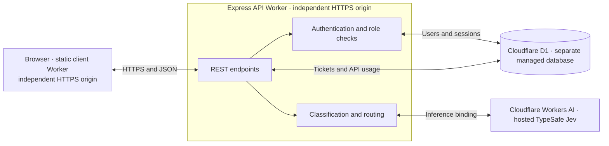

# TicketMaestro

TicketMaestro routes fictional NorthLink Internet support requests. Jev classifies the request by department and urgency, and the API saves it in D1. Tickets with uncertain results or unavailable inference enter manual review. The administrator dashboard lists registered users and aggregate ticket submission counts.

## Local setup

Use Node.js 22.14 or newer. Run these commands in `backend` using PowerShell.

```powershell
npm.cmd ci
npm.cmd run db:local
node scripts/demo-sql.js | Set-Content -Encoding ascii .wrangler/demo.sql
npx.cmd wrangler d1 execute DB --local --file .wrangler/demo.sql
npm.cmd run dev
```

In a second terminal at the repository root, run the static Worker.

```powershell
./backend/node_modules/.bin/wrangler.cmd dev --config frontend/wrangler.toml --port 8788
```

Visit `http://localhost:8788` for registration, sign-in, and the role-specific workspaces. Local mode runs with D1 and exercises manual review. For live routing against Jev with local D1, authenticate Wrangler to a Cloudflare account with Workers AI access, stop the local API process, and run `npm.cmd run dev:ai`. Live inference may incur provider charges.

| Role | Email | Assignment demo password |
| --- | --- | --- |
| User | john@john.com | 123 |
| Administrator | admin@admin.com | 111 |

Seed these accounts once in a dedicated grading database with synthetic data. The seed generator hashes the rubric-provided passwords before generating the SQL. Public registration always creates a user account and reserves the two demo email addresses.

## Separate-origin deployment

1. Confirm the instructor or TA approves the Option B provider and model, TypeSafe Jev (`typesafe/jev`) via Cloudflare Workers AI. Use a Cloudflare account with access to the model and sufficient Worker CPU for the scrypt password hashing work. See [Jev integration](https://developers.cloudflare.com/ai/models/typesafe/jev/).
2. From `backend`, run `npm.cmd ci`, authenticate Wrangler, then run `npx.cmd wrangler d1 create ticketmaestro`. Replace the placeholder `database_id` in `backend/wrangler.toml` with the returned ID.
3. Set `CLIENT_ORIGIN` to the planned HTTPS origin of the static Worker, without a trailing slash. Run `npm.cmd run db:remote` and, after generating the SQL as shown above, run `npx.cmd wrangler d1 execute DB --remote --file .wrangler/demo.sql`. For a fresh remote setup, create `.wrangler` before writing the SQL if it does not exist.
4. Run `npm.cmd run deploy` from `backend`. Put the API Worker's HTTPS origin in `frontend/public/config.js` and in the `connect-src` directive in `frontend/public/_headers`.
5. From the repository root, deploy the static Worker with `./backend/node_modules/.bin/wrangler.cmd deploy --config frontend/wrangler.toml`. Verify the actual client origin matches `CLIENT_ORIGIN` and the client and API origins differ. Both demo URLs use the client homepage, which opens the appropriate workspace after sign-in.
6. Check `/api/health` on the API origin. On the client, register and sign in as a new fictional user, submit the outage example, and confirm a department and urgency appear. Reload to verify persistence. Sign in as the demo administrator and confirm the new account appears. A ticket marked for manual review alone leaves live inference unverified.

## Architecture



The API issues eight-hour opaque bearer sessions and stores only token digests. The browser keeps the token in session storage for Milestone 1. Database roles are read on each protected request. Ticket history is scoped to the signed-in user, and the administrator endpoint verifies the administrator role on the server. Ticket and usage writes are atomic. API usage counts accepted submissions, including those saved for manual review.

| Method | Endpoint | Access |
| --- | --- | --- |
| GET | `/api/health` | Public |
| POST | `/api/auth/register`, `/api/auth/login` | Public |
| GET | `/api/auth/me` | Signed in |
| POST | `/api/auth/logout` | Signed in |
| GET, POST | `/api/tickets` | Signed in |
| GET | `/api/admin/users` | Administrator |
