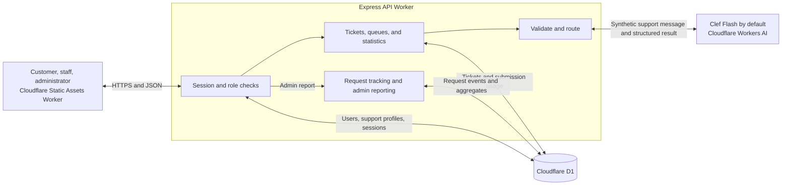

# TicketMaestro

TicketMaestro is a support portal for NorthLink Internet, a fictional Canadian internet provider. A customer submits a ticket and can follow its status. Cloudflare Clef Flash suggests a department and urgency, and the API routes a validated decision to Billing, Technical, Account, or General Support. Support staff can search queues, review uncertain results, and correct routing. Administrators can view API traffic and ticket statistics, delete tickets, and remove registered users.

## Run locally

Use Node.js 22.14 or newer. From `backend`, install dependencies, migrate the local D1 database, and seed the synthetic demonstration accounts and tickets.

```powershell
npm.cmd ci
npm.cmd run db:local
node scripts/demo-sql.js --tickets | Set-Content -Encoding ascii .wrangler/demo.sql
npx.cmd wrangler d1 execute DB --local --file .wrangler/demo.sql
npm.cmd run dev
```

From the repo root in another terminal, start the static client.

```powershell
./backend/node_modules/.bin/wrangler.cmd dev --config frontend/wrangler.toml --port 8788
```

Open [TicketMaestro](http://localhost:8788). The API listens on `http://localhost:8787`.

| Workspace | Demo account | Local password |
| --- | --- | --- |
| Customer | `john@john.com` | `123` |
| Technical support | `technical@example.test` | `NorthLink-demo-only-Workshop42!` |
| Administrator | `admin@admin.com` | `111` |

The seed also provides Billing, Account, and General Support logins. It can be rerun and preserves existing tickets and accounts. Use these credentials only in an isolated synthetic demo. [All demo accounts and macOS/Linux setup](backend/README.md#local-api-and-demo-data)

1. As a customer, submit a fictional outage, billing issue, sign-in problem, or plan inquiry. Open a ticket to see its ID, routing, and current status.
2. As staff, open your department’s queue. Search by message, ticket ID, or customer email. Filter by department or status, sort by priority or date, and open a ticket to change its assignment, priority, or status. The review queue lets staff assign tickets that need a human decision.
3. As an administrator, open **API usage** to see request volume, errors, processing time, and the most active endpoints and accounts. In **Ticket queue**, open a ticket to edit or delete it. In **Registered users**, remove an account and its tickets.

Offline mode saves fresh submissions for manual review. Seeded examples exercise the four queues and are identified as demo tickets. For live Clef Flash classification with the same local D1 database, sign in with `npx wrangler login` and start the API with `npm run dev:ai`. This connects directly to Workers AI without a `workers.dev` subdomain. See the [live AI setup](backend/README.md#local-api-and-demo-data).

## Architecture

The Express app creates an `AuthController`, `TicketController`, and `AdminController` to handle their respective routes. A `Ticket` builds the response for each role and applies staff edits. A `TicketClassifier` calls the configured AI model and decides whether a submission needs manual review. In the browser, `ApiClient` owns the sign-in session and sends authenticated requests for the workspaces.



The static client and API use separate origins. The API sends only the support message to the configured model. The validated choices, confidence, and model ID are stored separately from the current assignment and priority. Results below the routing threshold, invalid responses, timeouts, and provider failures go to manual review. Final status and routing changes are staff actions. The browser keeps an eight-hour session token in session storage and D1 stores its digest. The API checks roles and customer ticket ownership on each protected request.

## API reference

The local base URL is `http://localhost:8787/api`. All paths below are relative to it. Send request bodies as JSON with `Content-Type: application/json`. For protected routes, send the token returned by login in the `Authorization: Bearer <token>` header. A successful read or update returns HTTP 200 unless another status is listed.

### Authentication and health

| Method and path | Access | Request and result |
| --- | --- | --- |
| `GET /health` | Public | Returns `{"status":"ok","database":"connected"}` after a database query. |
| `POST /auth/register` | Public | Send `email` and a `password` of 12–128 characters. Returns 201 with `user`. New accounts have the customer role (`user`). |
| `POST /auth/login` | Public | Send `email` and `password`. Returns `token` and `user`. |
| `GET /auth/me` | Signed in | Returns the current `user`, including their role. |
| `POST /auth/logout` | Signed in | Ends the current session. Returns `{"signedOut":true}`. |
| `POST /auth/password-reset/request` | Public | Send `email`. Returns 202 with `accepted` and `delivery` (`local` or `email`) for a valid address, including an unknown one. |
| `POST /auth/password-reset/confirm` | Public | Send the reset `token` from the link and the new `password`. Returns `{"reset":true}` and ends all sessions for that account. Links expire after 30 minutes. |

### Tickets and administration

| Method and path | Access | Request and result |
| --- | --- | --- |
| `POST /tickets` | Signed in | Send `{"message":"My internet connection is down."}` (10–2,000 characters after trimming). Returns 201 with `ticket`. |
| `GET /tickets` | Signed in | Returns `tickets` and `next`. Customers see their own tickets and a submission count in `usage`. Staff and admins see all queues. |
| `GET /tickets/:id` | Ticket owner, staff, admin | Returns `ticket`. |
| `PATCH /tickets/:id` | Staff, admin | Send at least one of `department`, `priority`, or `status`. Include the `version` from the latest staff read to detect concurrent edits. Returns the updated `ticket`. |
| `GET /stats` | Staff, admin | Returns `total`, `byCategory` (original AI department), `byDepartment`, `byStatus`, and `byPriority`. |
| `GET /admin/tickets` | Admin | Lists all tickets, newest first by default. Returns `tickets` and `next`. |
| `GET /admin/users` | Admin | Returns up to 50 accounts in email order, plus `next` and `totals`. Each account includes its `id`. |
| `GET /admin/usage?days=7` | Admin | Accepts 7 (default), 30, or 90 days. Returns a summary, daily counts, endpoints, and top users for the period. |
| `DELETE /admin/tickets/:id` | Admin | Use the ticket ID and an empty request body. Permanently deletes the ticket. Returns `{"deleted":true}`. Historical submission and request counts are preserved. |
| `DELETE /admin/users/:id` | Admin | Use the account ID and an empty request body. Permanently removes the account, its tickets, sessions, password reset links, staff profile, and submission records. Previous API requests keep their event counts and lose the account association. Returns `{"deleted":true}`. Removing the signed-in admin's own account returns 409. |

Ticket lists accept `q` (message or ticket ID, also email for staff and admins), `department`, `status`, and `sort` (`newest` or `priority`). Filter departments by `billing`, `technical`, `account`, `general`, or `unassigned`. Status values are `manual_review`, `open`, `in_progress`, `resolved`, and `closed`. Ticket pages contain up to 30 entries. Pass the previous response's `next` value as `after` on the same endpoint with the same filters and sort. A `null` cursor marks the last page.

When editing a ticket, use `low`, `medium`, or `high` for priority. Use JSON `null` to clear a department or priority. Staff and admin ticket reads include the original `classification_model`, `classification_outcome`, `classification_department`, and `classification_urgency`. Existing clients can still read `jev_department` and `jev_urgency` as aliases.

Errors use `{"error":"…"}`. A malformed request returns 400, an invalid or expired session returns 401, and insufficient privileges return 403. A missing ticket or user returns 404 on deletion, including a repeated delete. A stale ticket version returns 409. Authentication and ticket-submission rate limits return 429.

This PowerShell example signs in as the local demo admin, lists registered users, and closes the session.

```powershell
$api = 'http://localhost:8787/api'
$body = @{ email = 'admin@admin.com'; password = '111' } | ConvertTo-Json
$session = Invoke-RestMethod -Method Post -Uri "$api/auth/login" -ContentType 'application/json' -Body $body
$headers = @{ Authorization = "Bearer $($session.token)" }
(Invoke-RestMethod -Uri "$api/admin/users" -Headers $headers).users | Select-Object id,email,role
Invoke-RestMethod -Method Post -Uri "$api/auth/logout" -Headers $headers
```

## Testing

Run the automated tests and offline model evaluation from `backend` after installing the locked dependencies with `npm.cmd ci`.

```powershell
npm.cmd test
npm.cmd run evaluate:ai -- --repeats 3
```

The test suite uses isolated SQLite databases and simulated inference. It covers authentication, password reset, routing, pagination, ticket edits, report totals, and admin deletion. The evaluation groups repeated observations by writing style. For live measurements, set `CLOUDFLARE_ACCOUNT_ID` and `CLOUDFLARE_API_TOKEN` and add `--live` to the evaluation command. Use `--model` to name a supported model or run `npm run evaluate:jev` to select Jev.

To test the running API in Postman, import the collection and set its `baseUrl`, `customerEmail`, `customerPassword`, `staffEmail`, and `staffPassword` variables. Run the collection in order to sign in, submit a synthetic ticket, read and update it, check statistics, and sign out. [Postman collection](backend/test/TicketMaestro.postman_collection.json)

To check deletion through the UI, register a disposable customer in the local demo and submit two tickets as that customer. Sign in as the admin, delete one ticket from **Ticket queue**, then remove the customer from **Registered users**. Verify the second ticket has disappeared from the queue and the removed account can no longer sign in.

## Deployment

The hosted demo runs on Cloudflare Workers. [Open TicketMaestro](https://ticketmaestro-client.kevyn-anthoni.workers.dev) · [API health](https://ticketmaestro-api.kevyn-anthoni.workers.dev/api/health)

Deploy the API and client as separate Cloudflare Workers. The deploying account needs access to D1, Workers AI, and Workers deployment. Use a Worker CPU limit sufficient for the application's scrypt password hashing.

1. **Prepare D1.** From `backend`, run `npm.cmd ci` and `npx.cmd wrangler login`. For a new database, run `npx.cmd wrangler d1 create ticketmaestro`. In `backend/wrangler.toml`, set the `DB` binding's `database_id` and `database_name` to the remote database. [Cloudflare D1 setup](https://developers.cloudflare.com/d1/get-started/)
2. **Configure the API.** Set `CLIENT_ORIGIN` to the client’s HTTPS origin (including the scheme, without a trailing slash). Keep the `AI` binding for live classification. To enable hosted password reset, configure a verified sender and a Resend secret. [Password reset configuration](backend/README.md#password-reset)
3. **Migrate and deploy the API.** From `backend`, run `npm.cmd run db:remote` and then `npm.cmd run deploy`. Record the API origin printed by Wrangler. For a hosted demonstration, seed the staff and admin accounts with private passwords using the backend guide. [Backend deployment and seeding](backend/README.md#cloudflare-deployment)
4. **Deploy the client.** In `frontend/public/config.js`, set `API_ORIGIN` to the deployed API origin. In `frontend/public/_headers`, set the `connect-src` directive to allow that same origin. From the repository root, run `./backend/node_modules/.bin/wrangler.cmd deploy --config frontend/wrangler.toml`. If the resulting client origin differs from `CLIENT_ORIGIN`, update the backend configuration and redeploy the API. [Client deployment guide](frontend/README.md#deploy)
5. **Verify the deployment.** Request `GET /api/health` on the deployed API and check for `"database":"connected"`. Sign in through the hosted client, submit a synthetic ticket, and open it in the staff queue to verify routing and persistence.
